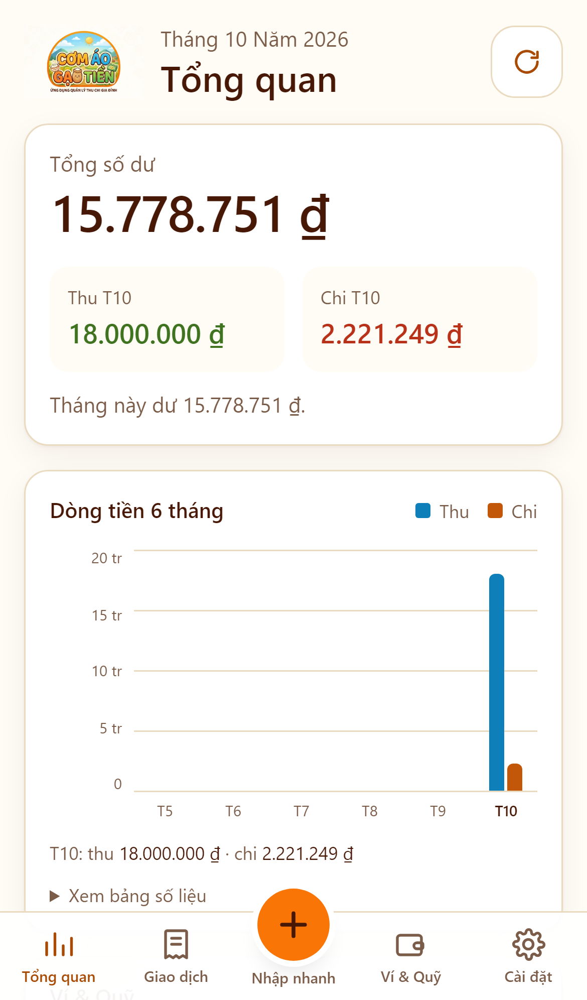
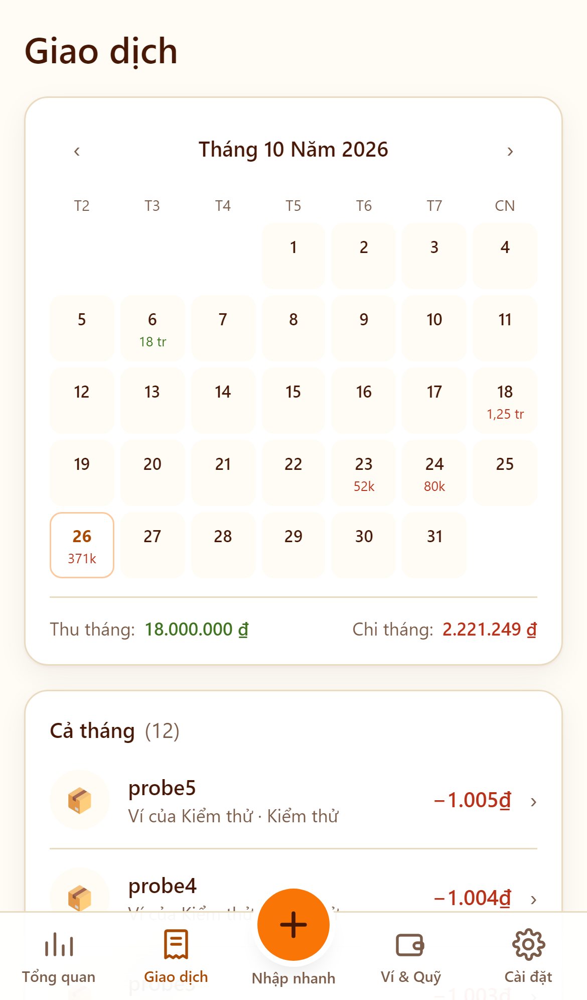
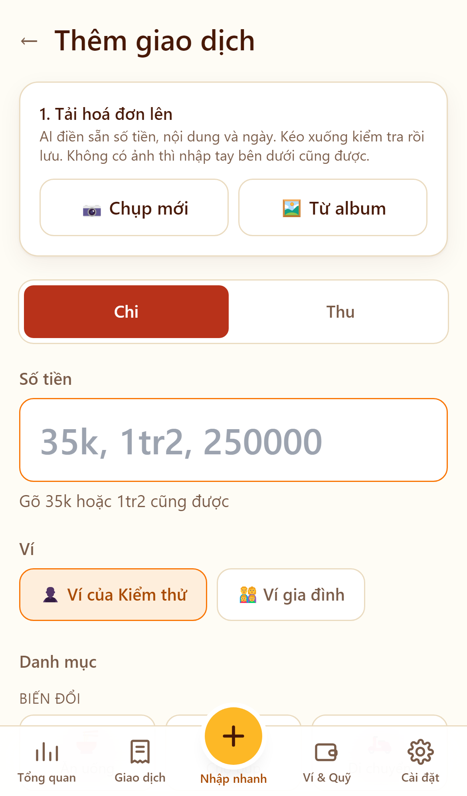
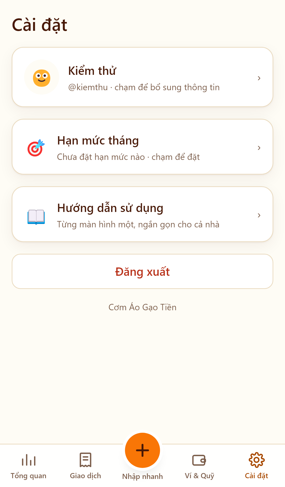
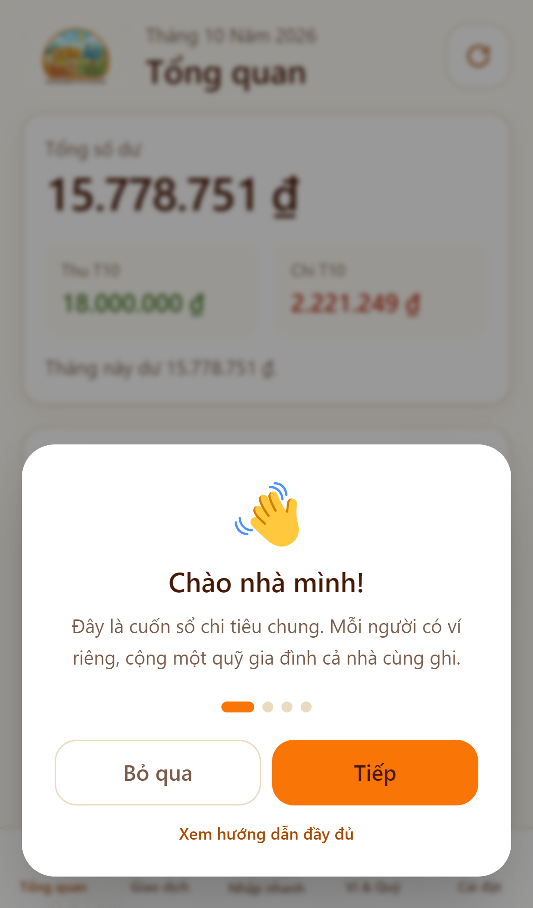

<div align="center">


**Ứng dụng quản lý thu chi cho một gia đình bốn người.**
PWA chạy trên iOS Safari · Chi phí vận hành 0 đồng/tháng.

</div>

---

## Ứng dụng này là gì

Một cuốn sổ chi tiêu chung cho đúng **bốn người trong một nhà** — không phải sản phẩm đa người dùng. Mỗi người có ví riêng mà người khác không nhìn thấy, cộng một quỹ gia đình cả nhà cùng ghi và cùng xem.

Điểm khác biệt chính: **chụp ảnh hoá đơn hoặc ảnh thông báo biến động số dư ngân hàng, AI tự đọc ra số tiền, nội dung, ngày và danh mục.** Không phải gõ tay từng khoản.

## Ảnh màn hình

| Màn hình chờ | Tổng quan | Giao dịch |
|---|---|---|
|  |  |  |

| Nhập nhanh | Cài đặt | Hướng dẫn lần đầu |
|---|---|---|
|  |  |  |

<sub>Chụp ở khung iPhone 13 Pro (390×844 @3x) bằng Playwright, trên dữ liệu thật.</sub>

## Tính năng

- **Ví cá nhân & quỹ gia đình** — tách bạch bằng Row Level Security ở tầng cơ sở dữ liệu, không phải bằng điều kiện trong code.
- **Đọc hoá đơn bằng AI** — nhận cả hoá đơn giấy lẫn ảnh chụp màn hình biến động số dư. Hiểu dấu `+`/`−` để phân biệt thu/chi, và đọc đúng ngày kiểu `14/10/26`.
- **Duyệt hàng loạt bằng cách vuốt** — chọn tối đa 5 ảnh một lượt, mỗi ảnh là một lời gọi riêng nên một tấm mờ không kéo đổ cả loạt. Kết quả hiện thành chồng thẻ kiểu Tinder: vuốt phải để duyệt, vuốt trái để sửa, rồi ghi tất cả bằng một lần `insert`.
- **Chống nhập trùng** — mỗi ảnh được băm SHA-256 và đối chiếu **trước** khi gọi AI, nên ảnh đã tải lên rồi không tốn thêm token nào.
- **Lịch giao dịch** — xem cả tháng, chạm vào ngày để lọc.
- **Hoá đơn định kỳ** — tiền nhà, điện, nước, học phí… kèm trạng thái quá hạn / sắp đến hạn và cảnh báo ngay trang chủ.
- **Hạn mức theo danh mục** — thanh tiến độ so với chi tiêu thực tế trong tháng.
- **Đồng bộ thời gian thực** — Supabase Realtime, cộng nút làm mới thủ công cho lúc iOS ngắt kết nối khi app chạy nền.
- **Sửa / xoá giao dịch** — chỉ người tạo mới thao tác được, do RLS quyết định.
- **Đếm lượt AI còn lại** — Gemini không hề báo còn bao nhiêu lượt, chỉ trả lỗi `429` khi đã hết, nên app tự đếm mỗi lần gọi vào một bảng dùng chung và hiện thanh tiến độ ở trang Cài đặt. Ngày được tính theo **giờ Pacific** — đúng lúc Google reset hạn mức — chứ không theo ngày UTC của cơ sở dữ liệu.
- **Phân biệt hai loại `429`** — cùng một mã lỗi nhưng là hai chuyện khác hẳn: chạm trần **15 lượt/phút** (chờ vài chục giây là xong, và một lượt 5 ảnh chạm tới nó sau ba lần) hay hết **500 lượt/ngày** (phải đợi reset). App đọc `quotaId` trong phần `details` để nói đúng việc cần làm, kèm số giây chờ lấy từ `RetryInfo`.
- **Hướng dẫn sử dụng** — popup 4 bước cho lần mở app đầu tiên, cộng một trang hướng dẫn đầy đủ tại [`/huong-dan.html`](public/huong-dan.html) mở được cả khi chưa đăng nhập.

## Công nghệ

| Lớp | Dùng gì | Vì sao |
|---|---|---|
| Framework | Next.js 15 (App Router) | Server Component giữ truy vấn ở phía máy chủ, máy khách tải ít JS |
| Giao diện | Tailwind CSS | Một file CSS đã gộp, không thêm request |
| Dữ liệu & đăng nhập | Supabase (PostgreSQL + Realtime) | Gói miễn phí đủ cho 4 người |
| AI | Google Gemini (`gemini-3.1-flash-lite`) | Gọi từ phía máy chủ, khoá không bao giờ ra máy khách |
| Triển khai | Vercel | Gói Hobby miễn phí |

Biểu đồ **không dùng thư viện** — viết bằng HTML/CSS thuần. Recharts từng được thử và bị gỡ: nó đẩy trang chủ từ 103 kB lên 217 kB JS chỉ vì một biểu đồ cột.

## Cài đặt

### 1. Supabase

Tạo project mới, rồi mở **SQL Editor** và chạy toàn bộ [`supabase/schema.sql`](supabase/schema.sql). File này chạy lại được nhiều lần mà không hỏng dữ liệu.

Sau đó vào **Authentication → Sign In / Providers → Email**:
- Bật **Enable**
- Tắt **Confirm email**

> Bước tắt xác nhận email là bắt buộc. Supabase gói miễn phí chỉ gửi được khoảng **2 email/giờ**, nên nếu bật xác nhận thì việc đăng ký sẽ thất bại ngay khi cả nhà cùng tạo tài khoản.

### 2. Biến môi trường

Sao chép [`.env.example`](.env.example) thành `.env.local`:

```bash
NEXT_PUBLIC_SUPABASE_URL=https://<project-ref>.supabase.co
NEXT_PUBLIC_SUPABASE_ANON_KEY=<publishable key>
GEMINI_API_KEY=<khoá từ Google AI Studio>
GEMINI_MODEL=gemini-3.1-flash-lite
GEMINI_DAILY_LIMIT=500
```

> `GEMINI_DAILY_LIMIT` chỉ là con số trang **Cài đặt** lấy làm mốc so sánh, không phải hạn mức thật. Google thay đổi hạn mức gói miễn phí nhiều lần và API **không bao giờ trả về số lượt còn lại**, nên hãy đọc con số thật trong project của bạn (Google AI Studio, hoặc Cloud Console → Generative Language API → Quotas) rồi điền vào đây.

> `NEXT_PUBLIC_SUPABASE_URL` chỉ là tên miền gốc. **Không** thêm `/rest/v1/` — thư viện tự nối đường dẫn, thừa hậu tố là mọi truy vấn đều hỏng.

### 3. Chạy

```bash
npm install
npm run dev
```

Mở `http://localhost:3000`, bấm tab **Đăng ký** để tạo tài khoản đầu tiên. Trigger trong cơ sở dữ liệu sẽ tự tạo hồ sơ và ví cá nhân cho từng người.

### 4. Đưa lên Vercel

Import repo, điền bốn biến môi trường ở trên. Lưu ý **tick đủ cả ba môi trường** Production / Preview / Development — biến `NEXT_PUBLIC_*` được nhúng cứng lúc build, nên sửa xong phải **Redeploy** mới có hiệu lực.

## Cách đăng nhập hoạt động

Supabase Auth không có provider username, nên mỗi tài khoản được lưu dưới một địa chỉ email nội bộ sinh từ tên đăng nhập (`bo` → `bo@comaogaotien.app`). Người dùng không bao giờ thấy hay gõ địa chỉ đó, và không có email nào được gửi đi. Lợi ích phụ: Supabase vốn bắt email phải duy nhất, nên tên đăng nhập tự động không trùng.

Phiên đăng nhập lưu trong cookie với hạn **400 ngày** (mức tối đa trình duyệt cho phép), nên đăng nhập một lần là dùng mãi cho tới khi xoá app.

## Vài quyết định đáng chú ý

- **Chỉ có giao diện sáng.** Nền `#FEFCF5` lấy trực tiếp từ pixel của file logo. Cam thương hiệu chỉ dùng làm nền, **không bao giờ làm màu chữ** — chữ trắng trên cam chỉ đạt 2,76:1, không đọc nổi. Logo vốn đã giải bài này bằng chữ nâu trên nền ấm (5,44:1).
- **Màu biểu đồ là xanh dương/cam, không phải xanh lá/đỏ.** Trên nền tối, mọi cặp xanh lá/đỏ đều rớt xuống ΔE 2–5 với người mù màu đỏ-lục. Cặp đang dùng đạt ΔE 21,9. Riêng số tiền trong danh sách vẫn giữ xanh/đỏ vì ở đó dấu `+`/`−` mới là thứ mang nghĩa.
- **Ẩn ví thay vì xoá.** Giao dịch bị xoá theo ví (`ON DELETE CASCADE`), nên xoá một ví đang dùng sẽ cuốn theo cả lịch sử. Ví rỗng thì xoá hẳn, ví có dữ liệu thì chỉ ẩn đi.
- **Thẻ vuốt không đi qua React.** Mỗi lần ngón tay nhúc nhích mà gọi `setState` là một lần render lại cả chồng thẻ. Thay vào đó cử chỉ ghi thẳng `transform` vào DOM qua `ref` và không đọc bất kỳ thuộc tính layout nào, nên trình duyệt chỉ việc hợp thành (composite). Đo trên 200 sự kiện `pointermove` với CPU bị bóp 4 lần: **0 lần reflow**, không có tác vụ dài, ~1,2 ms kịch bản mỗi sự kiện.
- **Số dư tính bằng view trong Postgres**, không cộng ở máy khách — nếu không, mỗi lần mở app điện thoại phải tải về toàn bộ lịch sử giao dịch chỉ để cộng lại.
- **Middleware không gọi `getUser()`** ở mỗi request. Đó là một vòng mạng 300–400ms trước khi trang kịp render. Nó đọc hạn dùng ngay trong cookie, chỉ liên lạc với Supabase khi token sắp hết hạn. Bảo mật vẫn do RLS đảm nhiệm ở từng truy vấn.

## Cấu trúc thư mục

```
app/
  (auth)/login/        đăng nhập + đăng ký
  (dashboard)/         5 tab chính, có thanh điều hướng dưới
  api/ai/parse-receipt/  gọi Gemini phía máy chủ
components/
  bills/ dashboard/ settings/ transactions/ wallets/ ui/
lib/
  bills.ts             tính trạng thái hoá đơn theo chu kỳ
  formatters.ts        tiền VND, ngày, và đọc "35k" / "1tr2"
  gemini.ts            prompt + schema cho AI
  supabase/            client cho trình duyệt và máy chủ
supabase/schema.sql    toàn bộ bảng, RLS, view và hàm
```

## Giới hạn đã biết

- Thiết kế cho **đúng 4 người**. Không có hệ thống mời hay phân quyền nhóm.
- Form đăng ký để mở công khai. Với app gia đình thì không sao, nhưng nếu muốn khoá lại sau khi đủ 4 tài khoản, tắt **Allow new users to sign up** trong Supabase.
- Chỉ tối ưu cho **iOS Safari**. Android và desktop vẫn chạy nhưng không phải đích ngắm.
