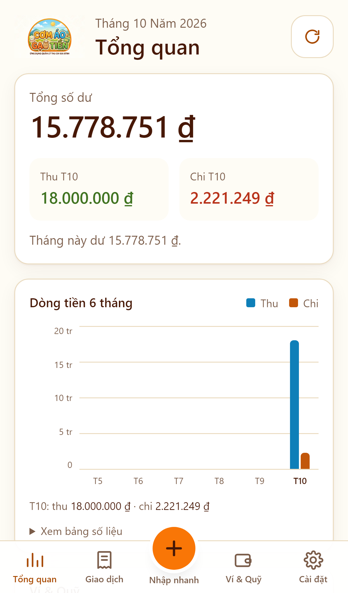
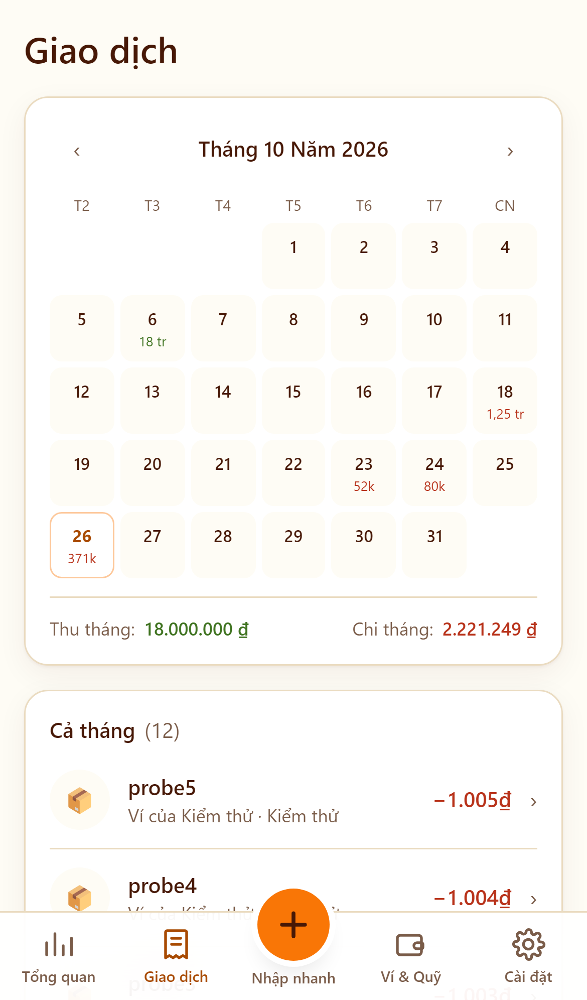
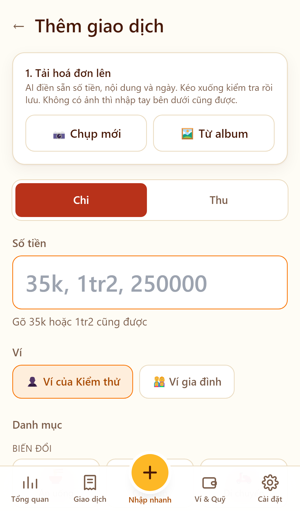
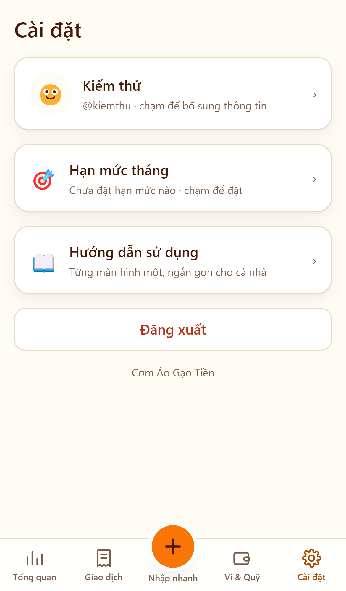
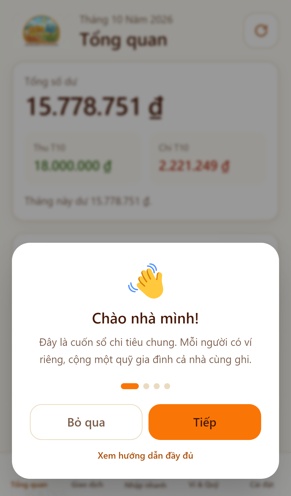

<div align="center">


**Ứng dụng quản lý thu chi cho một gia đình bốn người.**
PWA chạy trên iOS Safari · Chi phí vận hành 0 đồng/tháng.

</div>

---

## Ứng dụng này là gì

Một cuốn sổ chi tiêu chung cho đúng **bốn người trong một nhà** — không phải sản phẩm đa người dùng. Mỗi người có ví riêng mà người khác không nhìn thấy, cộng một quỹ gia đình cả nhà cùng ghi và cùng xem.

Điểm khác biệt chính: **chụp ảnh hoá đơn hoặc ảnh thông báo biến động số dư ngân hàng, AI tự đọc ra số tiền, nội dung, ngày và danh mục.** Không phải gõ tay từng khoản.

## Ảnh màn hình

| Màn hình chờ | Tổng quan | Giao dịch |
|---|---|---|
|  |  |  |

| Nhập nhanh | Cài đặt | Hướng dẫn lần đầu |
|---|---|---|
|  |  |  |

<sub>Chụp ở khung iPhone 13 Pro (390×844 @3x) bằng Playwright, trên dữ liệu thật.</sub>

## Tính năng

- **Ví cá nhân & quỹ gia đình** — tách bạch bằng Row Level Security ở tầng cơ sở dữ liệu, không phải bằng điều kiện trong code.
- **Đọc hoá đơn bằng AI** — nhận cả hoá đơn giấy lẫn ảnh chụp màn hình biến động số dư. Hiểu dấu `+`/`−` để phân biệt thu/chi, và đọc đúng ngày kiểu `14/10/26`.
- **Duyệt hàng loạt bằng cách vuốt** — chọn tối đa 5 ảnh một lượt, mỗi ảnh là một lời gọi riêng nên một tấm mờ không kéo đổ cả loạt. Kết quả hiện thành chồng thẻ kiểu Tinder: vuốt phải để duyệt, vuốt trái để sửa, rồi ghi tất cả bằng một lần `insert`.
- **Đăng nhập bằng Face ID / Touch ID** — bật một lần trong Cài đặt, từ đó khi phiên hết hạn chỉ cần nhìn vào máy thay vì gõ lại mật khẩu. Dùng passkey (WebAuthn) chuẩn: khuôn mặt không rời điện thoại, máy chủ chỉ giữ khoá công khai.
- **Nhập nhanh thân thiện với bàn phím iPhone** — phím tắt `000` / `k` / `tr` ngay dưới ô số tiền (bàn phím số của iOS không có chữ cái), hiểu cả "1tr250", "2 củ", "500 nghìn"; nút **Lưu & nhập tiếp** để ghi liền nhiều khoản; chạm một ghi chú cũ là chọn lại luôn danh mục của nó; nút Hôm nay / Hôm qua; thanh nút lưu luôn nằm trên màn hình.
- **Giữ ảnh hoá đơn gốc** — ảnh AI đã đọc được lưu vào bucket riêng tư, mở lại được từ màn sửa giao dịch. Ai thấy được giao dịch thì mới xem được ảnh.
- **Chống nhập trùng** — mỗi ảnh được băm SHA-256 và đối chiếu **trước** khi gọi AI, nên ảnh đã tải lên rồi không tốn thêm token nào.
- **Lịch giao dịch** — xem cả tháng, chạm vào ngày để lọc.
- **Hoá đơn định kỳ** — tiền nhà, điện, nước, học phí… kèm trạng thái quá hạn / sắp đến hạn và cảnh báo ngay trang chủ.
- **Hạn mức theo danh mục** — thanh tiến độ so với chi tiêu thực tế trong tháng.
- **Đồng bộ thời gian thực** — Supabase Realtime, cộng nút làm mới thủ công cho lúc iOS ngắt kết nối khi app chạy nền.
- **Sửa / xoá giao dịch** — chỉ người tạo mới thao tác được, do RLS quyết định.
- **Đếm lượt AI còn lại** — Gemini không hề báo còn bao nhiêu lượt, chỉ trả lỗi `429` khi đã hết, nên app tự đếm mỗi lần gọi vào một bảng dùng chung và hiện thanh tiến độ ở trang Cài đặt. Ngày được tính theo **giờ Pacific** — đúng lúc Google reset hạn mức — chứ không theo ngày UTC của cơ sở dữ liệu.
- **Phân biệt hai loại `429`** — cùng một mã lỗi nhưng là hai chuyện khác hẳn: chạm trần **15 lượt/phút** (chờ vài chục giây là xong, và một lượt 5 ảnh chạm tới nó sau ba lần) hay hết **500 lượt/ngày** (phải đợi reset). App đọc `quotaId` trong phần `details` để nói đúng việc cần làm, kèm số giây chờ lấy từ `RetryInfo`.
- **Hướng dẫn sử dụng** — popup 4 bước cho lần mở app đầu tiên, cộng một trang hướng dẫn đầy đủ tại [`/huong-dan.html`](public/huong-dan.html) mở được cả khi chưa đăng nhập.
- **Nhắc nhở cuối ngày bằng thông báo đẩy** — mỗi người tự chọn một giờ trong ngày (theo giờ tròn) để nhận thông báo, kèm số dư từng ví mình xem được ngay trong nội dung. Nếu hôm đó đã ghi ít nhất một khoản thì tiêu đề đổi thành "Tổng kết" thay vì nhắc nhở. Có nút **Gửi thử thông báo** riêng trong Cài đặt để xem trước và kiểm tra thiết bị đã đăng ký đúng chưa. Chạy trên Web Push chuẩn (không phụ thuộc dịch vụ ngoài nào có phí) — trên iOS bắt buộc phải **thêm app vào Màn hình chính** trước, đúng giới hạn của Safari.

## Công nghệ

| Lớp | Dùng gì | Vì sao |
|---|---|---|
| Framework | Next.js 15 (App Router) | Server Component giữ truy vấn ở phía máy chủ, máy khách tải ít JS |
| Giao diện | Tailwind CSS | Một file CSS đã gộp, không thêm request |
| Dữ liệu & đăng nhập | Supabase (PostgreSQL + Realtime) | Gói miễn phí đủ cho 4 người |
| AI | Google Gemini (`gemini-3.1-flash-lite`) | Gọi từ phía máy chủ, khoá không bao giờ ra máy khách |
| Triển khai | Vercel | Gói Hobby miễn phí |

Biểu đồ **không dùng thư viện** — viết bằng HTML/CSS thuần. Recharts từng được thử và bị gỡ: nó đẩy trang chủ từ 103 kB lên 217 kB JS chỉ vì một biểu đồ cột.

## Cài đặt

### 1. Supabase

Tạo project mới, rồi mở **SQL Editor** và chạy toàn bộ [`supabase/schema.sql`](supabase/schema.sql). File này chạy lại được nhiều lần mà không hỏng dữ liệu.

Sau đó vào **Authentication → Sign In / Providers → Email**:
- Bật **Enable**
- Tắt **Confirm email**

> Bước tắt xác nhận email là bắt buộc. Supabase gói miễn phí chỉ gửi được khoảng **2 email/giờ**, nên nếu bật xác nhận thì việc đăng ký sẽ thất bại ngay khi cả nhà cùng tạo tài khoản.

### 2. Biến môi trường

Sao chép [`.env.example`](.env.example) thành `.env.local`:

```bash
NEXT_PUBLIC_SUPABASE_URL=https://<project-ref>.supabase.co
NEXT_PUBLIC_SUPABASE_ANON_KEY=<publishable key>
GEMINI_API_KEY=<khoá từ Google AI Studio>
GEMINI_MODEL=gemini-3.1-flash-lite
GEMINI_DAILY_LIMIT=500
SUPABASE_SERVICE_ROLE_KEY=<service_role key>
NEXT_PUBLIC_VAPID_PUBLIC_KEY=<xem bên dưới>
VAPID_PRIVATE_KEY=<xem bên dưới>
VAPID_SUBJECT=mailto:ban@example.com
CRON_SECRET=<chuỗi ngẫu nhiên tự chọn>
```

> `GEMINI_DAILY_LIMIT` chỉ là con số trang **Cài đặt** lấy làm mốc so sánh, không phải hạn mức thật. Google thay đổi hạn mức gói miễn phí nhiều lần và API **không bao giờ trả về số lượt còn lại**, nên hãy đọc con số thật trong project của bạn (Google AI Studio, hoặc Cloud Console → Generative Language API → Quotas) rồi điền vào đây.

> `NEXT_PUBLIC_SUPABASE_URL` chỉ là tên miền gốc. **Không** thêm `/rest/v1/` — thư viện tự nối đường dẫn, thừa hậu tố là mọi truy vấn đều hỏng.

> `SUPABASE_SERVICE_ROLE_KEY` lấy ở **Project Settings → API**, cạnh `anon key`. Chỉ route gửi thông báo nhắc nhở dùng, không bao giờ lộ ra máy khách.

> Sinh cặp khoá VAPID bằng `npx web-push generate-vapid-keys`. `CRON_SECRET` tự chọn một chuỗi ngẫu nhiên (ví dụ `openssl rand -hex 32`) — một khi biến này tồn tại, Vercel tự gắn nó vào header `Authorization` của mọi Cron Job, không cần cấu hình thêm gì.

### 3. Chạy

```bash
npm install
npm run dev
```

Mở `http://localhost:3000`, bấm tab **Đăng ký** để tạo tài khoản đầu tiên. Trigger trong cơ sở dữ liệu sẽ tự tạo hồ sơ và ví cá nhân cho từng người.

### 4. Đưa lên Vercel

Import repo, điền các biến môi trường ở trên. Lưu ý **tick đủ cả ba môi trường** Production / Preview / Development — biến `NEXT_PUBLIC_*` được nhúng cứng lúc build, nên sửa xong phải **Redeploy** mới có hiệu lực.

File [`vercel.json`](vercel.json) đã khai sẵn 24 Cron Job (mỗi giờ UTC một job, tất cả gọi chung route gửi nhắc nhở) — không cần tạo gì thêm trên dashboard, chỉ cần `CRON_SECRET` đã điền ở bước trên. Gói Hobby miễn phí giới hạn mỗi Cron Job chạy **tối đa 1 lần/ngày**, nên thay vì một job chạy mỗi giờ (không được phép), có 24 job riêng biệt — mỗi job vẫn đúng "1 lần/ngày" theo luật, nhưng cộng lại phủ đủ 24 giờ. Route tự tính giờ Việt Nam thật tại thời điểm được gọi, nên không phụ thuộc Vercel gọi đúng phút.

## Cách đăng nhập hoạt động

Supabase Auth không có provider username, nên mỗi tài khoản được lưu dưới một địa chỉ email nội bộ sinh từ tên đăng nhập (`bo` → `bo@comaogaotien.app`). Người dùng không bao giờ thấy hay gõ địa chỉ đó, và không có email nào được gửi đi. Lợi ích phụ: Supabase vốn bắt email phải duy nhất, nên tên đăng nhập tự động không trùng.

### Giữ đăng nhập (gần như) vĩnh viễn

Cookie phiên có hạn **400 ngày** — mức tối đa trình duyệt cho phép — và **được gia hạn lại 400 ngày mỗi lần mở app**. Chỉ khi bỏ app không mở quá 400 ngày, hoặc Supabase thu hồi phiên, mới phải đăng nhập lại.

Có một cái bẫy riêng của Safari làm điều này hỏng trước đây: cookie ghi bằng JavaScript (`document.cookie`) bị **ITP cắt còn tối đa 7 ngày**, bất kể max-age ghi gì. Thư viện Supabase phía trình duyệt ghi cookie đúng kiểu đó mỗi lần làm mới token, nên điện thoại bỏ không một tuần là bị đăng xuất. Cách sửa:

- Mỗi lần trình duyệt tự ghi phiên, nó gọi `/api/auth/touch`, route này gửi trả chính các cookie đó qua header `Set-Cookie` (không bị giới hạn 7 ngày).
- Cookie đánh dấu `cagt-sess-srv` cho middleware biết lần ghi gần nhất có phải từ máy chủ không; nếu không, lần tải trang kế tiếp sẽ tự ghi lại từ máy chủ.
- Khi middleware làm mới token rồi chuyển hướng, cookie mới được mang theo (trước đây bị rơi mất — token cũ đã dùng xuất hiện lại khiến Supabase thu hồi cả phiên).
- Cookie phiên được giải mã đúng chuẩn base64url (`atob` thuần ném lỗi với ký tự `-` và `_`).

### Khi phiên không gia hạn được

Nếu Supabase từ chối refresh token (đã bị thu hồi, đã dùng rồi, tài khoản bị xoá), app **xoá sạch cookie phiên và đưa về màn đăng nhập** kèm thông báo "Phiên đăng nhập đã hết hạn". Việc này xảy ra ở cả hai nơi: middleware (khi chuyển trang) và `SessionGuard` (khi app đang mở trên một màn hình). Mất mạng tạm thời **không** bị coi là hết phiên.

Để phiên không tự hết hạn phía Supabase, giữ nguyên mặc định trong **Authentication → Sessions**: không bật *Time-box user sessions* và *Inactivity timeout*.

### Face ID / Touch ID

Bật trong **Cài đặt → Đăng nhập bằng Face ID** (cần đăng nhập bằng mật khẩu ít nhất một lần). Sau đó màn đăng nhập hiện nút Face ID lên đầu, và chạm vào ô tên đăng nhập là iOS gợi ý passkey ngay trên bàn phím.

Cơ chế: `@simplewebauthn` xác minh chữ ký từ Secure Enclave, rồi máy chủ tạo một token magic-link một lần bằng service key (không gửi email nào) và đổi nó thành phiên Supabase bình thường — cùng loại cookie 400 ngày như đăng nhập bằng mật khẩu. Mỗi challenge chỉ dùng được một lần và hết hạn sau 5 phút, vì passkey iCloud luôn báo bộ đếm chữ ký bằng 0 nên đó là lớp chống phát lại duy nhất.

> Passkey gắn với **đúng tên miền** nơi nó được tạo. Bật Face ID trên domain production thì chỉ dùng được ở đó, không dùng được trên URL preview của Vercel.

## Vài quyết định đáng chú ý

- **Chỉ có giao diện sáng.** Nền `#FEFCF5` lấy trực tiếp từ pixel của file logo. Cam thương hiệu chỉ dùng làm nền, **không bao giờ làm màu chữ** — chữ trắng trên cam chỉ đạt 2,76:1, không đọc nổi. Logo vốn đã giải bài này bằng chữ nâu trên nền ấm (5,44:1).
- **Màu biểu đồ là xanh dương/cam, không phải xanh lá/đỏ.** Trên nền tối, mọi cặp xanh lá/đỏ đều rớt xuống ΔE 2–5 với người mù màu đỏ-lục. Cặp đang dùng đạt ΔE 21,9. Riêng số tiền trong danh sách vẫn giữ xanh/đỏ vì ở đó dấu `+`/`−` mới là thứ mang nghĩa.
- **Ẩn ví thay vì xoá.** Giao dịch bị xoá theo ví (`ON DELETE CASCADE`), nên xoá một ví đang dùng sẽ cuốn theo cả lịch sử. Ví rỗng thì xoá hẳn, ví có dữ liệu thì chỉ ẩn đi.
- **Cả hệ thống dùng một cuốn lịch: giờ Việt Nam.** Vercel chạy hàm ở UTC và Supabase lưu ở UTC, nên `new Date()` cùng `current_date` trả về *hôm qua* trong khoảng 0–7 giờ sáng giờ Việt Nam — và trả về *tháng trước* vào mùng 1, đúng lúc cả nhà mở xem tổng kết. Mọi câu hỏi "hôm nay là ngày nào" đều đi qua `householdParts()` ở phía ứng dụng và `household_today()` ở phía cơ sở dữ liệu. Ngày tháng dạng `YYYY-MM-DD` được neo ở giữa trưa UTC chứ không phải nửa đêm, để không múi giờ nào kéo lệch được một ngày.
- **Thẻ vuốt không đi qua React.** Mỗi lần ngón tay nhúc nhích mà gọi `setState` là một lần render lại cả chồng thẻ. Thay vào đó cử chỉ ghi thẳng `transform` vào DOM qua `ref` và không đọc bất kỳ thuộc tính layout nào, nên trình duyệt chỉ việc hợp thành (composite). Đo trên 200 sự kiện `pointermove` với CPU bị bóp 4 lần: **0 lần reflow**, không có tác vụ dài, ~1,2 ms kịch bản mỗi sự kiện.
- **Số dư tính bằng view trong Postgres**, không cộng ở máy khách — nếu không, mỗi lần mở app điện thoại phải tải về toàn bộ lịch sử giao dịch chỉ để cộng lại.
- **Middleware không gọi `getUser()`** ở mỗi request. Đó là một vòng mạng 300–400ms trước khi trang kịp render. Nó đọc hạn dùng ngay trong cookie, chỉ liên lạc với Supabase khi token sắp hết hạn. Bảo mật vẫn do RLS đảm nhiệm ở từng truy vấn.
- **24 Cron Job thay vì một job chạy mỗi giờ.** Gói Hobby của Vercel chỉ cho mỗi Cron Job chạy tối đa 1 lần/ngày — không có lựa chọn "mỗi giờ" ở mức miễn phí. Khai 24 job cố định, mỗi job đúng một giờ UTC, đều gọi chung một route: cộng lại thành độ phân giải theo giờ mà không vi phạm giới hạn, không cần Supabase `pg_cron`/`pg_net` (chưa chắc có sẵn tuỳ dự án) hay dịch vụ cron ngoài nào có phí.
- **Thông báo đẩy dùng khoá riêng của ứng dụng (VAPID), không qua Firebase hay OneSignal.** `web-push` ký gói tin bằng cặp khoá tự sinh, gửi thẳng tới endpoint mà trình duyệt cấp — không dịch vụ trung gian nào biết nội dung thông báo, và không giới hạn số lượt theo gói miễn phí của ai khác ngoài chính trình duyệt/push service của hệ điều hành.

## Cấu trúc thư mục

```
app/
  (auth)/login/        đăng nhập + đăng ký
  (dashboard)/         5 tab chính, có thanh điều hướng dưới
  api/ai/parse-receipt/  gọi Gemini phía máy chủ
  api/cron/push-reminders/  Vercel Cron gọi mỗi giờ, gửi nhắc nhở ai đến lượt
components/
  bills/ dashboard/ settings/ transactions/ wallets/ ui/
lib/
  bills.ts             tính trạng thái hoá đơn theo chu kỳ
  categories.ts        khớp nhãn danh mục của AI với danh mục trong DB
  formatters.ts        tiền VND, ngày, và đọc "35k" / "1tr2"
  gemini.ts            prompt + schema cho AI
  push.ts              gửi Web Push, dựng nội dung nhắc nhở (dùng chung cron + nút test)
  push-client.ts        phần việc chỉ chạy được ở trình duyệt (khoá VAPID, phát hiện đã cài app)
  supabase/            client cho trình duyệt và máy chủ, quy tắc cookie phiên
  webauthn.ts          Face ID: challenge một lần, đổi passkey thành phiên Supabase
  passkey-client.ts    phần Face ID chạy ở trình duyệt
public/sw.js           service worker: nhận push, mở app khi chạm thông báo
supabase/schema.sql    toàn bộ bảng, RLS, view, hàm và bucket ảnh hoá đơn
tests/                 test cho đọc số tiền, cookie phiên, quy tắc ví/hoá đơn (npm test)
vercel.json             24 Cron Job gửi nhắc nhở
```

## Giới hạn đã biết

- Build trên máy **Windows cần Node 22 hoặc 24 LTS**. Node 26 trên Windows trả lỗi `EISDIR` cho `readlink` lên file thường và webpack của Next 15 không xử lý được. Vercel không bị ảnh hưởng.
- Ảnh hoá đơn của một giao dịch do người khác xoá sẽ còn lại trong Storage — chính sách chỉ cho người tải lên xoá ảnh của mình.

- Thiết kế cho **đúng 4 người**. Không có hệ thống mời hay phân quyền nhóm.
- Form đăng ký để mở công khai. Với app gia đình thì không sao, nhưng nếu muốn khoá lại sau khi đủ 4 tài khoản, tắt **Allow new users to sign up** trong Supabase.
- Chỉ tối ưu cho **iOS Safari**. Android và desktop vẫn chạy nhưng không phải đích ngắm.
